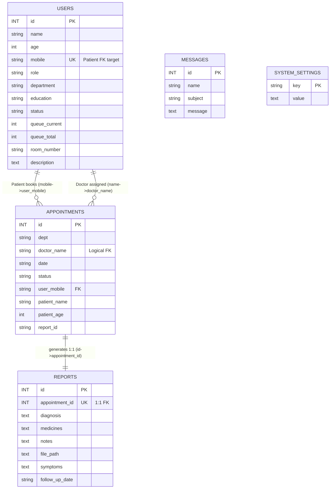

# Entity-Relationship (ER) Diagram for Smart Hospital Management System

## Visual ER Diagram (Mermaid - Copy to https://mermaid.live for PNG)




## How to Generate PNG Image:
1. Copy the Mermaid code above to https://mermaid.live/
2. Actions → Download PNG → Save as `ER_Diagram.png`

## Complete SQL Schema Dump (Extracted from server.py):
```sql
-- users
CREATE TABLE IF NOT EXISTS users (
    id INT AUTO_INCREMENT PRIMARY KEY,
    name VARCHAR(255) NOT NULL,
    age INT,
    mobile VARCHAR(20) UNIQUE NOT NULL,
    role VARCHAR(50) DEFAULT 'patient',
    department VARCHAR(100),
    education VARCHAR(100),
    status VARCHAR(50) DEFAULT 'Available',
    queue_current INT DEFAULT 0,
    queue_total INT DEFAULT 0,
    room_number VARCHAR(50),
    description TEXT,
    created_at TIMESTAMP DEFAULT CURRENT_TIMESTAMP
);

-- appointments  
CREATE TABLE IF NOT EXISTS appointments (
    id INT AUTO_INCREMENT PRIMARY KEY,
    dept VARCHAR(100) NOT NULL,
    doctor_name VARCHAR(255),
    date VARCHAR(100) NOT NULL,
    status VARCHAR(50) DEFAULT 'Pending',
    user_mobile VARCHAR(20) NOT NULL,
    patient_name VARCHAR(255),
    patient_age INT,
    report_id VARCHAR(50),
    FOREIGN KEY (user_mobile) REFERENCES users(mobile)
);

-- reports
CREATE TABLE IF NOT EXISTS reports (
    id INT AUTO_INCREMENT PRIMARY KEY,
    appointment_id INT NOT NULL UNIQUE,
    diagnosis TEXT,
    medicines TEXT,
    notes TEXT,
    file_path TEXT,
    symptoms TEXT,
    follow_up_date VARCHAR(100),
    created_at TIMESTAMP DEFAULT CURRENT_TIMESTAMP
);

-- messages
CREATE TABLE IF NOT EXISTS messages (
    id INT AUTO_INCREMENT PRIMARY KEY,
    name VARCHAR(255),
    subject VARCHAR(255),
    message TEXT,
    created_at TIMESTAMP DEFAULT CURRENT_TIMESTAMP
);

-- system_settings
CREATE TABLE IF NOT EXISTS system_settings (
    `key` VARCHAR(100) PRIMARY KEY,
    `value` TEXT
);
```

## Relationship Cardinality Table:
| Relationship | Cardinality | Field Mapping |
|--------------|-------------|---------------|
| Patient → Appointments | 1:M | users.mobile → appointments.user_mobile |
| Doctor → Appointments | 1:M | users.name → appointments.doctor_name (logical) |
| Appointment → Report | 1:1 | appointments.id → reports.appointment_id (UNIQUE) |

**Design Note**: Single `users` table implements Role-Based Access via `role` field (Single Table Inheritance pattern) for optimal query performance.


information


If your professor or external examiner asks you during your project viva/presentation: "Why did you choose to put Admin, Patient, and Doctor all in a single USERS table instead of making three separate tables?"

Here is exactly what you should say to impress them and show that you understand advanced software engineering concepts:

1. "To Optimize the Login System"

"I used a single table because everyone needs to log in at the same URL. If I had three tables, the backend API would have to search the Patient table, then the Doctor table, then the Admin table just to see who is trying to log in. By combining them, my code only has to run one fast SQL query (SELECT * FROM users WHERE mobile = ?) and it instantly knows their role. This makes the system much faster and reduces backend server load."

2. "To write cleaner, DRY (Don't Repeat Yourself) Code"

"If I made three tables, I would have had to write the exact same columns (name, mobile, password/id, created_at) three different times in the database. As a developer, I wanted to follow the 'DRY' principle. By using a single table, I reduced data redundancy."

3. "To make future updates easier"

"If the hospital later wants to add a new role like 'Nurse' or 'Pharmacist', I don't need to create entirely new tables and rewrite my database logic. I can just add a new role string into my single USERS table structure. It makes my application highly scalable."

Summary for your defense: Tell them you used a database design pattern called "Single Table Inheritance". Teachers love hearing professional terms like that. It proves you didn't just write code randomly, but you actually thought about the performance and structure of your database!